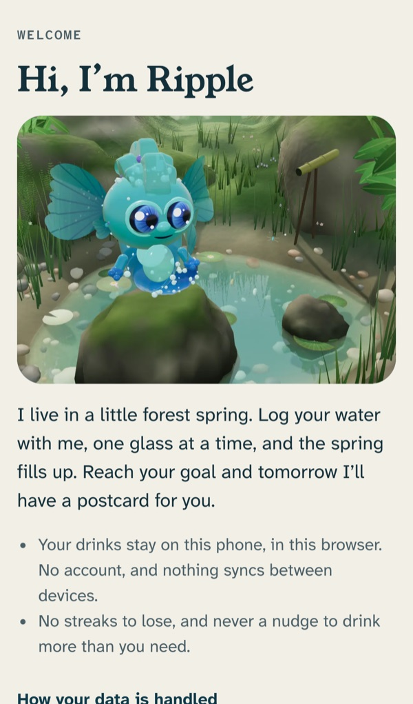
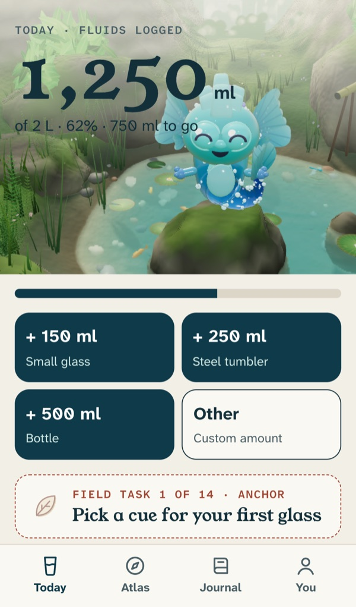
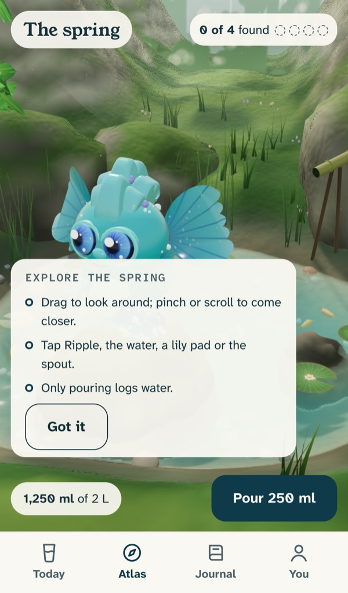
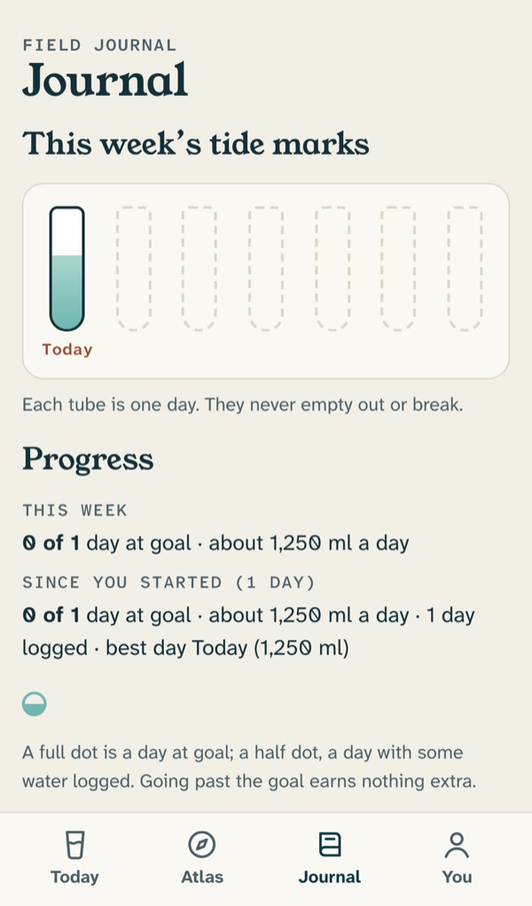
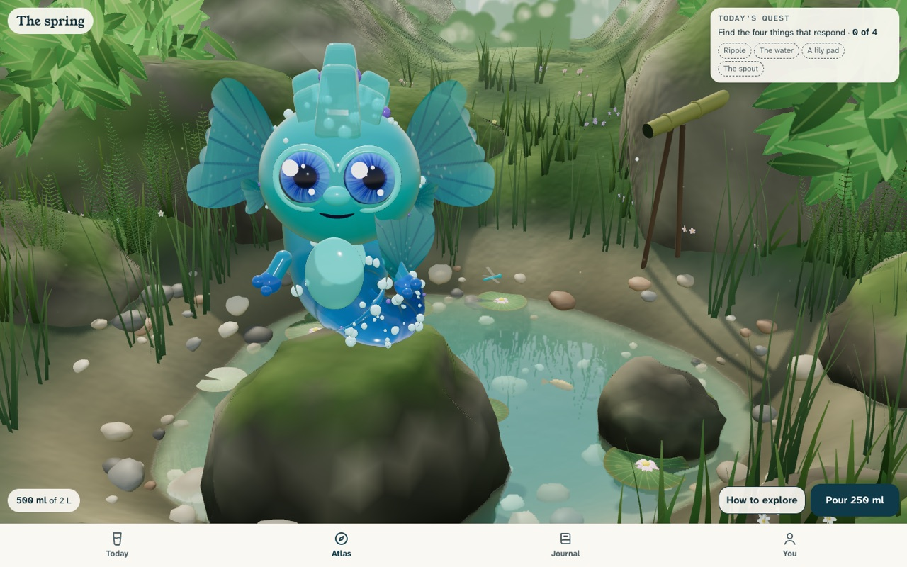

# WaterBuddy

**A gentle water tracker for every age, with a 3D companion called Ripple who lives in a forest spring.**
Log a glass and the spring fills up. Reach your goal and a postcard arrives the next morning.

**Live app:** https://waterbuddy-app-ivory.vercel.app (installable; works offline after the first visit)
**Release:** v1.0.0 (branch `v1`, tag `v1.0.0`)

<p align="center">
  
  
  
  
</p>

## Contents

- [What it does](#what-it-does)
- [Design principles](#design-principles)
- [Tech stack](#tech-stack)
- [Repository structure](#repository-structure)
- [Run it locally](#run-it-locally)
- [Testing](#testing)
- [Deployment](#deployment)
- [Privacy and data](#privacy-and-data)
- [Known limitations](#known-limitations)
- [Documentation](#documentation)
- [How it was built](#how-it-was-built)

## What it does

| Screen | What you can do |
|---|---|
| **Onboarding** | Pick an age band (4–8, 9–13, 14–17, 18–64, 65+). A suggested daily goal is shown with its reason and source, labelled *"a starting point, not a prescription"*. Choose cups and units. |
| **Today** | Ripple's spring rises with the day's total. Quick-add 150 / 250 / 500 ml (editable) or a custom amount. See the total, percentage and amount left. Edit or delete any drink; every log has **Undo**. An accidental double tap logs once. |
| **Atlas** | The spring, full screen and explorable: drag to look around, pinch or scroll to zoom. Tap Ripple, the water, a lily pad or the bamboo spout to see them react. The daily quest is to find all four. Exploring never logs water; only **Pour** does. |
| **Journal** | This week's tide marks, weekly and 30-day progress, a month strip, field tasks and stickers, postcards (one the morning after each goal day), a line-a-day reflection and the full drink history. |
| **You** | Goal and age band, units (ml, cups, fl oz) and a converter, cup and bottle sizes, wake and sleep times, text size, high contrast, reduced motion, 3D on or off, sound, install, export your data, delete everything. |

**Hydration safeguards:**
- **Sip guard:** "Sip, don't rush" appears after more than a litre in an hour.
- **Last call:** two hours before sleep, Today stops counting down.
- **Past the goal:** drinks are still logged accurately, but nothing rewards drinking more.
- **Celebration:** at most once a day.

**Accessibility and devices:**
- **Without a graphics chip,** or with 3D switched off, the spring becomes a still picture. Logging is never affected.
- **Accessibility:** the 3D canvas is hidden from screen readers; the scene can be looked around with arrow keys; reduced motion is respected; touch targets are at least 48 px.

<p align="center">
  
</p>

## Design principles

The full rules are in [`docs/safety-rules.md`](docs/safety-rules.md), and the reasoning behind each choice is in [`docs/decisions.md`](docs/decisions.md). In short:

- **More is not better.**
  - No streaks to lose.
  - No rewards for going past the goal.
  - Never a nudge to drink more than you need.
- **Goals are guidance, not prescriptions.**
  - Every suggested goal cites its source: EFSA 2010 adequate intakes, and NIN 2024 for India.
  - A goal outside the usual range asks for confirmation.
- **Children are protected.**
  - Under 13, a grown-up check guards goal and data changes.
  - Under 18: no accounts, no social features, no links out.
- **Local first.** Your data stays on your device. There's no account and no tracking.
- **3D is optional.** Logging never waits for the scene.

## Tech stack

| Area | Technology |
|---|---|
| Web app | React 19, TypeScript, Vite 6 (multi-page build: the app plus `/lab/`) |
| 3D | three.js r186: a custom scene engine (`src/lab/engine`) reused by the app; Ripple is a compressed GLB (meshopt + WebP textures, about 1 MB) |
| Storage | IndexedDB via Dexie (drinks, profile, vessels, postcards, discoveries) |
| Offline and install | vite-plugin-pwa (injectManifest) with a custom service worker (`src/sw.ts`) |
| Tests | Vitest + Testing Library (unit), Playwright (Chromium as Pixel 7, WebKit as iPhone 14), axe-core (accessibility) |
| Reminder API (not used by V1) | Python 3.12, FastAPI, web push (VAPID), Postgres on Render |
| Content and tooling | JSON content with sources; Python scripts to validate content, build icons and art, and check GLB budgets |
| CI | GitHub Actions: lint, typecheck, unit tests, build, browser tests, API tests, content checks |
| Hosting | Vercel (static build) |

## Repository structure

```
apps/
  web/                    the WaterBuddy app (React + TypeScript + Vite PWA)
    src/
      screens/            Today, Atlas, Journal, You, Onboarding, settings screens
      components/         Pond (Ripple's spring with still-picture fallback), Converter, stickers, postcard art
      pond/               PondStage: mounts the 3D scene inside the app
      lab/                Hero Lab: the 3D spring engine (scene, Ripple, water, camera) and its own page
      data/               Dexie database and repository functions
      domain/             pure logic: goals, units, summaries, tips, reminders, age modes
      hooks/              useLogDrink (guards and Undo), useToday (daily rollover), ...
      ui/                 shared UI: toasts, goal picker, parent gate
      sw.ts               service worker (offline cache, push)
    e2e/                  Playwright suites: smoke, V1 flows, Hero Lab, accessibility (axe)
    public/               icons, manifest assets, Ripple's model and still picture
  api/                    FastAPI reminder service (kept for a later release)
content/                  goals, field tasks, postcards and privacy notice as JSON, with sources
tools/                    Python: content validator, icon and art builders, GLB checker (with tests)
docs/                     product, QA, safety, privacy and accessibility documents; see docs/README.md
.github/workflows/        CI and the reminder scheduler
render.yaml               Render blueprint for the API
```

## Run it locally

**Web app** (Node 20 or later; the version is in `.nvmrc`):

```bash
cd apps/web
npm install
npm run dev
```

Open the address Vite prints. Useful extras:
- **The Hero Lab:** `/lab/`.
- **Developer tools:** add `?dev`.
- **Frame-rate meter:** add `?perf`.
- **Force the live 3D spring** on a software renderer: add `?3d=on`.

**Production build:**

```bash
npm run build && npm run preview
```

**Reminder API** (optional, Python 3.12; V1 doesn't use it):

```bash
cd apps/api
python3.12 -m venv .venv
.venv/bin/pip install -r requirements-dev.txt
.venv/bin/uvicorn app.main:app --reload
```

To connect the web app to it, copy `apps/web/.env.example` to `apps/web/.env`.

## Testing

```bash
# Web app: lint, types, unit tests, production build
cd apps/web && npm run lint && npm run typecheck && npm test && npm run build

# Browser tests (Chromium + WebKit), including axe accessibility checks
npx playwright install chromium webkit && npm run test:e2e

# API, content and tools
cd apps/api && .venv/bin/ruff check . && .venv/bin/pytest
python3 tools/validate_content.py && python3 -m pytest tools -q
```

**Results at the v1.0.0 release (14 Nov 2026):**

| Check | Result |
|---|---|
| Unit tests (Vitest) | 145 / 145 |
| Typecheck, lint | clean |
| Browser suite on the production build (96 tests, emulated Pixel 7 and iPhone 14) | 92 passed, 3 skipped by design. The 1 failure was a wrong assertion in a new test; it was fixed and the test re-run, passing on both engines |
| Live site check (phone and desktop sizes, real GPU) | onboarding, live spring, logging, Journal, You, offline reload, manifest and icons: all working, no page errors |
| Real iPhone / Android | **not tested yet**; the procedure is in [`docs/hero-lab-device-testing.md`](docs/hero-lab-device-testing.md) |

Full details: [`docs/v1.md`](docs/v1.md).

## Deployment

**Web (Vercel):**
- Deploy `apps/web` as a static site (root directory `apps/web`).
- `apps/web/vercel.json` sets the SPA rewrites and the caching headers for the service worker.
- V1 is built with `VITE_API_URL` empty, so it runs with no server.

**API (Render, for a later release):**
- `render.yaml` deploys `apps/api` with Postgres.
- Set `WB_ALLOWED_ORIGINS` to the web app's address, plus the VAPID keys from `python -m app.vapid`.
- `.github/workflows/reminders.yml` triggers due reminders. It needs the `WB_API_URL` variable and the `WB_CRON_TOKEN` secret.

**Installing on a phone:**
- **iPhone:** open the site in Safari, tap Share, then **Add to Home Screen**.
- **Android:** in Chrome, tap ⋮, then **Install app**.

## Privacy and data

- **Where data lives:** everything (drinks, goal, journal) is stored in IndexedDB in this browser on this device.
- **What V1 doesn't do:** there's no account, no analytics and no syncing.
  - Another browser or device starts fresh.
  - Clearing site data removes everything.
- **Your controls:** **You → Download my data** exports a JSON file, and **Delete everything** erases it all.
- **More detail:** the in-app notice is [`content/privacy-notice.json`](content/privacy-notice.json); the data map is [`docs/privacy.md`](docs/privacy.md).

## Known limitations

- **Background reminders aren't in V1.** The app says so in the Reminders section and in About.
  - The push code and API exist, but end-to-end delivery (the scheduler and server configuration) was never finished.
  - No notification is simulated.
- **Real devices:** no testing on physical phones yet. All automated testing used emulated devices on a Mac.
- **Older and mid-range phones:** phones without a graphics chip get the still spring, not the live one. Performance on mid-range phones hasn't been measured.
- **Reviews:** the health and legal reviews for children and teens haven't been done ([`docs/health-review.md`](docs/health-review.md), [`docs/launch-checklist.md`](docs/launch-checklist.md)).
- **The 3D scene's toys** (Ripple, the water, the pads, the spout) respond to pointer and touch only. Logging and settings are fully keyboard and screen-reader accessible.
- **Leftover code:** older prototype code (the earlier Pip character, tidepool and Waterverse) is still in `src/three` and `src/components`, unused by V1.

## Documentation

See [`docs/README.md`](docs/README.md) for an index. The most useful documents:
- **[V1 release notes and QA](docs/v1.md):** features, test results, limitations, install steps.
- **[Safety rules](docs/safety-rules.md)** and **[decision log](docs/decisions.md):** the product's rules and the reasons behind them.
- **[Hero Lab report](docs/hero-lab.md)** and **[QA report](docs/hero-lab-qa.md):** how the 3D spring was built and tested.
- **[Real-device test procedure](docs/hero-lab-device-testing.md):** about 60 manual steps for iPhone and Android.

## How it was built

WaterBuddy was designed and directed by Kirtan Dabhi ([@KDDD4344](https://github.com/KDDD4344)).

Much of the code, the tests and the documentation was written with **Claude Code**, an AI coding assistant, under that direction.
- **Kirtan's part:** product decisions, the character and scene direction, requirements and reviews.
- **The record:** the decision log and QA reports describe what was built, how it was tested and what remains unverified.

## License

No license has been chosen yet, so the default applies: all rights reserved.
